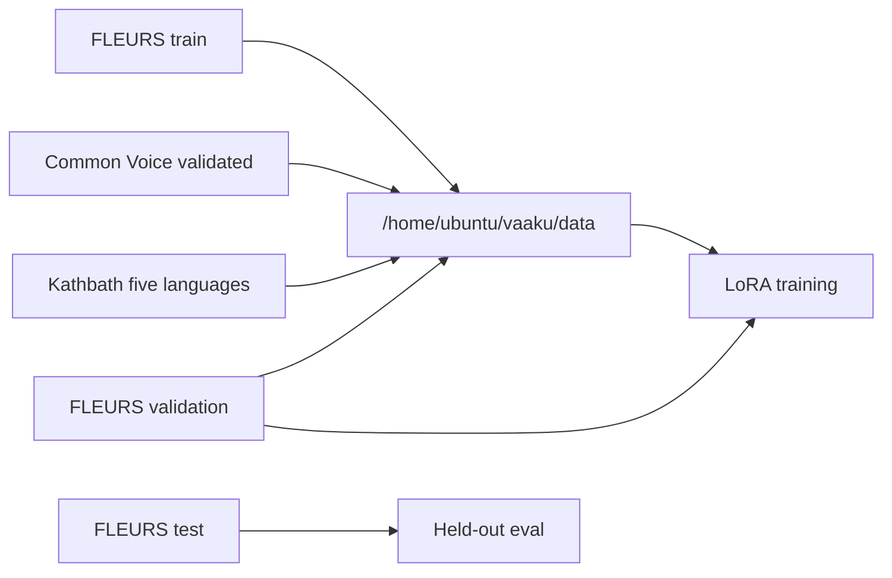

# Vaakku — Open Indic Speech

Multilingual speech-to-text for Tamil (`ta`), Telugu (`te`), Hindi (`hi`), Kannada (`kn`), and Malayalam (`ml`).

The model family is `vaakku-whisper-small`. The demo, when it exists, is Vaakku Studio. The code remote is [Akshit11318/vaaku-whisper](https://github.com/Akshit11318/vaaku-whisper). The intended Hugging Face repo is [rudra11/vaakku-whisper-small](https://huggingface.co/rudra11/vaakku-whisper-small). That model repo has not been published from this project.

This is a fine-tuning and engineering project. It is not a claim of production accuracy. No training run has happened, so there is no WER or CER to report.

## What is actually done

| Item | State |
|---|---|
| GPU box | `g5.xlarge` in `ap-south-1` is set up. NVIDIA driver 580.178.04 sees an A10G with 23028 MiB. `nouveau` was unbound and blacklisted. |
| Data disk | Empty instance store, 233 GiB, mounted at `/home/ubuntu/vaaku`. About 217 GiB free after formatting. Root is 64 GiB and is not for datasets. |
| Setup scripts | On `main`, commit `ec9f835`: `scripts/setup_aws_box.sh`, `scripts/verify_gpu.sh`. |
| Datasets | Chosen below. **None have been downloaded.** |
| Training, evaluation, publishing | Not built. No checkpoints. |
| API, Vaakku Studio, Docker, CI | Not built. |
| Config and logging package | On `feat/whisper-lora-experiment` only. Python syntax checks pass. It has not been imported, because `pydantic` is not installed in the local environment yet, and there is no training script calling it. |

Stopping or terminating the instance deletes `/home/ubuntu/vaaku`. A reboot keeps it. Copy checkpoints to EBS or S3 before a stop. After a stop/start, run `bash scripts/setup_aws_box.sh` again.

## Branches

`main` stays the box setup that has already been run.

New experiments go on `feat/` branches. The first one is `feat/whisper-lora-experiment`. Do not train from uncommitted files, and do not put experiment code directly on `main`.

## Experiment 1 datasets

Five sources were candidates. Three are in the first training mix. Two are not. Vistaar is a benchmark list, not a sixth corpus to unpack on top of the others.

Nothing below is on the disk yet. Download only after checking the license page, and only onto `/home/ubuntu/vaaku/data/raw`. Do not commit audio, and do not upload it to the Hugging Face model repo.

### In the first experiment

| Dataset | Role | Languages | License we are relying on | Where |
|---|---|---|---|---|
| [google/fleurs](https://huggingface.co/datasets/google/fleurs) | Train, validation, and the only reported test set | `hi_in`, `ta_in`, `te_in`, `kn_in`, `ml_in` | [CC-BY-4.0](https://huggingface.co/datasets/google/fleurs). The dataset card states CC-BY. | Hugging Face |
| [Common Voice scripted 27.0](https://mozilladatacollective.com/organization/cmfh0j9o10006ns07jq45h7xk) | Extra training audio. Validated clips only. | Hindi, Tamil, Telugu, Malayalam. **Kannada is not in the 27.0 scripted catalog.** | [CC0-1.0](https://commonvoice.mozilla.org/en/terms). Do not re-host the files. Do not try to identify speakers. | Mozilla Data Collective |
| [ai4bharat/Kathbath](https://huggingface.co/datasets/ai4bharat/Kathbath) | Extra training audio | Hindi, Tamil, Telugu, Kannada, Malayalam, plus seven other languages we will not download | Packaging is CC0. AI4Bharat says the text comes from the IndicCorp web crawl and that they do not own that raw text. Read the dataset card before download. | Hugging Face |

FLEURS splits stay the official ones. Train on `train`, watch `validation` during training, and score `test` only after training. The same sentence split is aligned across languages, so a Hindi train sentence is not reused as a Tamil test sentence. Do not reshuffle FLEURS into a new random split.

Common Voice and Kathbath are training material. Their clips do not enter the reported test set. If a later run wants a Kathbath test number, that split has to stay out of training, and the report has to say so.

Published archive sizes from the Common Voice 27.0 catalog, not measurements from our disk:

| Language | 27.0 archive | Validated hours |
|---|---|---|
| Hindi | 546.57 MB | 15.71 hours in the 27.0 datasheet (26.74 recorded, 485 speakers) |
| Tamil | 8.58 GB | 234.82 hours in the 27.0 datasheet (425.42 recorded, 984 speakers) |
| Telugu | 65.47 MB | Not copied from the 27.0 datasheet. The 26.0 datasheet reported 0.87 validated hours. |
| Malayalam | 221.37 MB | Not copied from the 27.0 datasheet. The 26.0 datasheet reported 4.1 validated hours. |
| Kannada | Not listed in scripted 27.0 | No Common Voice file in this experiment |

Telugu and Kannada will mostly come from FLEURS and Kathbath. That imbalance is real. Do not hide it behind one average.

Kathbath's card describes 1,684 hours across 12 languages. Download only the five languages above. The full 12-language unpack can be on the order of the whole 217 GiB disk. Check `df -h /home/ubuntu/vaaku` before unpacking.

### Not in the first experiment

| Dataset | Why it is waiting |
|---|---|
| [ai4bharat/IndicVoices](https://huggingface.co/datasets/ai4bharat/IndicVoices) | CC-BY-4.0 on the dataset card. The card describes 23.7k hours across 22 languages, 11.2k of them transcribed. The project GitHub README still describes an earlier 12k-hour cut. We have not downloaded either release, and the transcribed portion is larger than this disk. Later experiment, not this one. |
| [AI4Bharat/vistaar](https://github.com/AI4Bharat/vistaar) | A list of benchmarks and training packs (Kathbath, FLEURS, Common Voice, IndicTTS, MUCS, GramVaani). The GitHub repo is MIT for its code and the IndicWhisper checkpoints. Each audio pack keeps its own license. Training on Vistaar's copy of FLEURS or Common Voice and then scoring those same benchmarks would leak. Experiment 1 does not download Vistaar. |

IndicTTS, MUCS, and GramVaani are not part of this experiment.

## How a sample will be used



The test arrow does not pass through training. That rule is the one to keep when the data scripts land.

## Box

Details and commands are in [docs/aws_training.md](docs/aws_training.md). Disk paths are in [data/README.md](data/README.md).

```bash
bash scripts/setup_aws_box.sh
source /etc/profile.d/vaaku.sh
bash scripts/verify_gpu.sh
```

`make box-setup` and `make box-check` call those two scripts. There is no `make train` yet, because there is no training script.

## What this repo will not do

GitHub Actions will not launch the instance, start training, or upload a model. Publishing, when the script exists, is a command you run after evaluation. Raw datasets stay off GitHub and off the public model repo.
