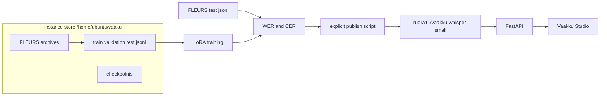

# Architecture

Vaakku is one repository. `main` holds the code. The GPU box is started by hand. A push does not train or publish.

The reported test set is the official FLEURS test split. Common Voice and Kathbath, when added later, stay out of that split.

Training selects checkpoints by validation loss. Word error rate is computed by the separate evaluation script.
